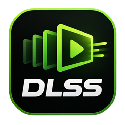

<h1 align="center">FrameGen Manager</h1>

  <b>This project is no longer maintained</b> 
  Please move to the new project <b>FrameGen Manager Next</b>

  
  
  
  

  English | <a href="README.md">中文</a>

> [!IMPORTANT]
> This project is no longer maintained. No further bug fixes, driver / game compatibility updates,
> or bundled asset updates will be released. Please continue with the new project:
>
> - New project: <https://github.com/XiaoQAQ10086/FrameGen-Manager-Next>
> - GitHub downloads: <https://github.com/XiaoQAQ10086/FrameGen-Manager-Next/releases>
> - Netdisk download: <https://pan.quark.cn/s/adea7ed4f2b2>

## Final version: 1.7.0

1.7.0 is the closing release of the old project. On its **first launch**, it automatically removes
every deployment this tool left behind in your games:

1. Removes deployed frame generation, Smooth Motion, and DLSS5 files;
2. Deletes the matching per-game deployment backups and empty `dlssg_sm86` folders;
3. Shows a shutdown notice with links to the new repository, GitHub downloads, and the netdisk;
4. Disables deployment, legacy cleanup, and updates from then on.

If a file is locked by a game or security software, 1.7.0 keeps the corresponding backup and asks
you to retry.

**Close all games before launching 1.7.0.**

Installers are available in [Releases](../../releases). Older versions remain there for archival purposes.

## Migrating to the new project

1. Download the new installer from the new project's Releases page or the netdisk;
2. Launch the old 1.7.0 first and wait for it to finish cleanup;
3. Open FrameGen Manager Next, scan or add your games again, and redeploy.

Game saves, game installations, and Steam / Epic platform data are not affected. Old settings and
backups do not need to be migrated to the new project.

## About this project (archive)

FrameGen Manager was a Windows desktop tool that deployed the proxy DLL and configuration from
[sdli1995/dlssg_for_sm86](https://github.com/sdli1995/dlssg_for_sm86) into game folders to enable
DLSS frame generation on RTX 20 / 30 series GPUs, and integrated DLSS5 neural rendering. It offered:

- frame generation deployment / restore, including runtime, GPU routing, and entry-point conflicts;
- detection, deployment, and thorough removal of Smooth Motion and DLSS5;
- all assets bundled, with no extra download after installation;
- Chinese and English interfaces.

These features are no longer maintained after 1.7.0. Build, test, and packaging instructions remain
in [DEVELOPING.md](DEVELOPING.md) for reference.

## License

[MIT](LICENSE). See [THIRD_PARTY_NOTICES.txt](THIRD_PARTY_NOTICES.txt) for third-party licenses.
