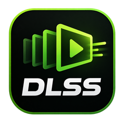

<h1 align="center">FrameGen Manager</h1>

  <b>本项目已停止更新维护</b> 
  请转移至新项目 <b>FrameGen Manager Next</b>

  
  
  
  

  中文 | <a href="README.en.md">English</a>

> [!IMPORTANT]
> 本项目已停止更新维护，后续不再修复问题、适配新驱动 / 游戏，也不再更新内置资产。
> 请使用新项目继续部署：
>
> - 新项目：<https://github.com/XiaoQAQ10086/FrameGen-Manager-Next>
> - GitHub 下载：<https://github.com/XiaoQAQ10086/FrameGen-Manager-Next/releases>
> - 网盘下载：<https://pan.quark.cn/s/adea7ed4f2b2>

## 最后版本：1.7.0

1.7.0 是旧项目的收尾版。更新到该版本后，**首次启动会自动清理本工具在全部游戏中留下的部署**：

1. 清除已部署的帧生成、Smooth Motion 与 DLSS5 文件；
2. 删除对应的游戏部署备份记录与空的 `dlssg_sm86` 目录；
3. 清理完成后弹出停更公告，提供新项目仓库、GitHub 下载与网盘三个入口；
4. 此后禁用部署、清理旧版、更新等功能。

如果有文件正被游戏或安全软件占用，1.7.0 会保留对应备份并提示重试。

**建议先退出所有游戏，再启动 1.7.0。**

安装包在 [Releases](../../releases) 中；旧版本也保留在同一页面，仅作存档。

## 迁移到新项目

1. 从新项目 Releases 或网盘下载安装包；
2. 先启动旧版 1.7.0，等它完成清理；
3. 打开 FrameGen Manager Next，重新扫描游戏库或手动添加游戏，再重新部署。

游戏存档、游戏本体和 Steam / Epic 等平台数据不受影响；旧项目的配置与备份不需要迁移到新项目。

## 项目简介（存档）

FrameGen Manager 是一个 Windows 桌面工具，用于给 RTX 20 / 30 系显卡的游戏一键部署
[sdli1995/dlssg_for_sm86](https://github.com/sdli1995/dlssg_for_sm86)
的代理 DLL 与配置，并接入 DLSS5 神经渲染。它曾提供：

- 帧生成部署 / 还原，自动处理运行库、显卡路由和入口冲突；
- Smooth Motion 与 DLSS5 的检测、部署和彻底卸载；
- 内置全部资产，安装后无需另外下载；
- 中英文界面。

这些功能在 1.7.0 后不再维护。构建、测试与打包说明见 [DEVELOPING.md](DEVELOPING.md)，仅作文档留存。

## 许可

[MIT](LICENSE)。第三方组件许可见 [THIRD_PARTY_NOTICES.txt](THIRD_PARTY_NOTICES.txt)。
